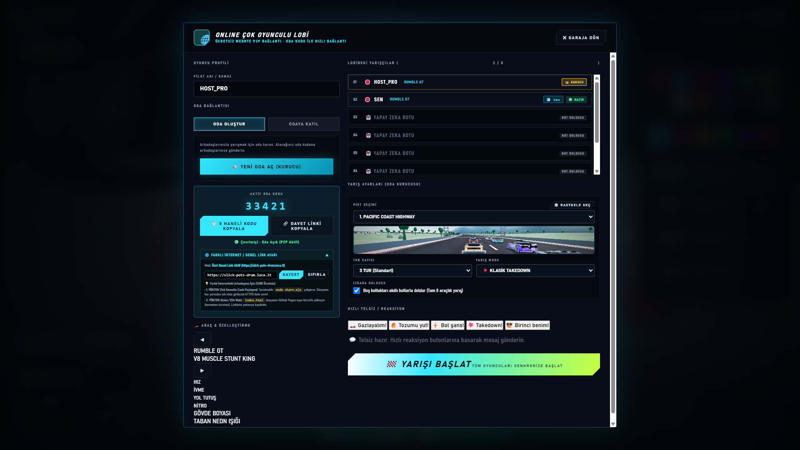

# 🏎️ RUMBLE GT: REAL WORLD RACING 3D (Online Multiplayer Master Edition)

> 🎮 **Canlı Oyunu Hemen Tarayıcıda Oyna:**  
> 👉 **[https://doganaslan.github.io/rumble/](https://doganaslan.github.io/rumble/)** 👈  
> *(7/24 Kesintisiz Çevrimiçi · Sıfır Kurulum · Tüm Bilgisayar ve Telefonlarda Çalışır)*

---

**RUMBLE GT**, efsanevi **Asphalt 8: Airborne** ve klasik arcade yarış oyunlarından ilham alınarak geliştirilmiş; **Three.js** ve **Cannon-es** fizik motorları üzerinde çalışan, tek dosya (single-file HTML) mimarisine sahip, sıfır harici varlık (prosedürel grafik ve Web Audio sentezi) ile çalışan yüksek tempolu bir 3D yarış oyunudur.

---

Oyun doğrudan çift tıklamayla [start_game.bat](file:///c:/Users/dogan/OneDrive/Masa%C3%BCst%C3%BC/rumble/start_game.bat) veya [index.html](file:///c:/Users/dogan/OneDrive/Masa%C3%BCst%C3%BC/rumble/index.html) üzerinden hiçbir derleme veya kurulum gerektirmeden tarayıcıda çalışır.

---

## 🌐 ÜCRETSİZ ONLINE ÇOK OYUNCULU MOD (Multiplayer with Friends)

Oyun artık hiçbir ücretli servis, üyelik veya harici sunucu aboneliği gerektirmeyen **%100 ücretsiz WebRTC P2P (Peer-to-Peer)** online çok oyunculu altyapıya sahiptir!

### 1. Oda Açma ve Arkadaş Davet Etme (Oda Kurucusu):
1. Garaj ekranında yeşil **"🌐 ONLINE OYNA"** butonuna veya üst bardaki **"🌐 ONLINE LOBİ"** butonuna tıklayın.
2. Açılan lobi ekranında rumuzunuzu belirleyin ve **"🚀 YENİ ODA AÇ (KURUCU)"** butonuna tıklayın.
3. Sistem anında size 5 haneli özel bir **Oda Kodu** (Örn: `32720`) üretir.
4. **"📋 KODU KOPYALA"** butonuna basarak kodu arkadaşınıza gönderebilir veya **"🔗 DAVET LİNKİ"** butonuna basarak doğrudan bağlantıyı (`index.html?room=32720`) paylaşabilirsiniz.
5. Pisti (10 pist arasından), tur sayısını ve boş koltukların akıllı botlarla doldurulup doldurulmayacağını seçin.
6. Arkadaşlarınız lobiye bağlandığında isimleri ve araçları anlık olarak ızgarada görünür.
7. Hazır olduğunuzda **"🏁 YARIŞI BAŞLAT"** butonuna basın; tüm oyuncular aynı anda senkronize olarak yarışa başlar!

### 2. Açılmış Bir Odaya Katılma (Misafir Oyuncu):
1. Garajdan **"🌐 ONLINE OYNA"** butonuna tıklayın.
2. **"ODAYA KATIL"** sekmesine geçin.
3. Arkadaşınızın gönderdiği Oda Kodunu girin ve **"🔗 ODAYA KATIL"** butonuna basın (veya doğrudan davet linkine tıklayın).
4. Odaya anında bağlanırsınız; kurucu yarışı başlattığında senkronize olarak yarışa girersiniz.

### 3. Çevrimdışı / Yerel Ağ (LAN) Sunucusu:
İnternet bağlantısı olmayan veya düşük gecikmeli yerel ağ yarışları için oyuna sıfır bağımlılıklı Node.js LAN sunucusu eklenmiştir. [start_game.bat](file:///c:/Users/dogan/OneDrive/Masa%C3%BCst%C3%BC/rumble/start_game.bat) çalıştırıldığında yerel HTTP sunucusu ve LAN modülü arka planda hazır hale gelir.

---

## 🎮 Kontroller (Klavye & Dokunmatik Ekran)

| Tuş | Eylem | Açıklama |
| :--- | :--- | :--- |
| **W** / **Yukarı Ok** | **Gaz** | Hızlanma ve ileri sürüş |
| **S** / **Aşağı Ok** | **Fren / Geri** | Yüksek hızda güçlü hidrolik fren, durunca geri vites |
| **A** / **Sol Ok** | **Sol Direksiyon** | Açısal dönüş ve apeksleme |
| **D** / **Sağ Ok** | **Sağ Direksiyon** | Açısal dönüş ve apeksleme |
| **SHIFT** | **Nitro Burst** | 3 kademeli arcade nitro püskürtme (Yoldaki 3D tüplerden toplanır) |
| **SPACE** (Boşluk) | **El Freni / Drift** | Virajlarda kayma, drift açısı ve stil puanı |
| **C** | **Kamera Değiştir** | 4 farklı kamera modu (Takip, Kaput, Kokpit, Tampon) |
| **B** | **Dikiz Aynası** | Arkadaki rakipleri anlık kontrol etme |
| **P** / **ESC** | **Duraklat / Menü** | Pause menüsü ve ayarlar |
| **R** | **Respawn** | Aracı yola geri ışınlama |
| **T** | **Otopilot** | Yapay zekanın aracı otomatik sürmesini sağlama |

---

## 💎 Son Güncellemeler ve Çözülen Sorunlar

1. **Yolun Üstüne Çıkan Sütunlar ve Havada Duran Adalar ("Yolları yukarıda tutan sütunlar"):**
   - Viyadük ayaklarının 140 metrelik gövdelerinin yol eğimlerinde alttaki ya da yakındaki yol parçalarını kesip delmesi engellendi. Ayaklar yerleştirilmeden önce 3D ışın ve mesafe kontrolüyle taranır; başka bir yol segmentine yakınsa otomatik iptal edilir.
   - Havada duran adalar (`buildAbyssProps` ve `buildInfield`) için hem 2D yatay güvenlik marjı (`w * 1.5 + 45m`) hem de 3D dikey kota kontrolü (`Math.abs(y - roadY) > 14m`) eklendi. Hiçbir ada veya kaya yolu kesemez.
   - Tribünlerin (grandstand) 4 köşe noktası yol sınırlarına göre test edilerek başlangıç virajında asfaltın kenarına taşma sorunu sıfırlandı.
   - Şehir binaları (`buildCityProps`) tüm döndürülmüş 4 köşe noktalarıyla `roadClear(6.0m)` üzerinden kontrol edilerek gökdelen köşelerinin bariyerleri aşması engellendi.

2. **Geri Sayım ve Yarış Başlangıcı Senkronizasyonu ("Ekranda Her Şey Gidince Yarışa Başlansın"):**
   - 3, 2, 1 ve GO! geri sayımı esnasında hem oyuncu hem de bot araçların gaz, fren ve direksiyon kontrolleri sıfırlanır; araçların hız ve açısal hızları 0.000 m/s değerinde kilitlenir.
   - Geri sayım arayüzü ekrandan tamamen silinip kaybolduğu an yarış başlar.

3. **Görünmez Kalkan (Invisible Shield) Sorunu:**
   - Araçlar arasında 4.2 metre mesafeden tetiklenen yapay itme alanı kaldırıldı.
   - Çarpışma kapsül yarıçapı `0.94m`ye (araç gövde genişliği 1.88m) çekildi.
   - Araçlar artık kapı kapıya, tekerlek tekerleğe ve tampon tampona sıfır boşlukla fiziksel temas kurabiliyor.

4. **Üst Düzey ve Akıllı Yapay Zeka Botları (Smarter & Higher Level AI):**
   - Botların beceri seviyeleri yükseltildi (300 - 325 km/h azami hız).
   - **Hava Koridoru (Slipstream Drafting):** Botlar rakibin veya oyuncunun arkasına (2.5 - 24m) girdiklerinde ek %8 ivme kazanır ve nitro doldururlar.
   - **Agresif Nitro:** Botlar düzlüklerde, hafif viraj çıkışlarında, rampalardan uçarken ve sollama anlarında nitrolarını akıllıca patlatırlar.

---

## 🗺️ 10 Tam Ölçekli Yarış Pisti

1. **Track 0 - PACIFIC COAST HIGHWAY** (1100 segment, 6.6 km, Sahil Kayalıkları & Okyanus)
2. **Track 1 - GRAND CANYON DESERT** (1100 segment, 6.6 km, Kırmızı Kanyon & Kaktüsler)
3. **Track 2 - ALPINE SNOW PASS** (1100 segment, 6.6 km, Karlı Çam Ağaçları & Donmuş Zemin)
4. **Track 3 - SKYLINE ABYSS VIADUCT** (1100 segment, 6.6 km, Bulut Denizi Üzerinde Viyadük)
5. **Track 4 - DOWNTOWN GRAND PRIX** (1100 segment, 6.6 km, Gökdelenler & Şehir Pisti)
6. **Track 5 - AMALFI COAST CLASSIC** (1100 segment, Gün Batımı Sahil Rallisi)
7. **Track 6 - SAHARA ENDURANCE RING** (1100 segment, Alacakaranlık Çöl Arenası)
8. **Track 7 - NORDIC FJORD SPRINT** (1100 segment, Gece Kutup Işıkları & Kar Fırtınası)
9. **Track 8 - NEBULA SPIRAL** (1100 segment, Gece Yıldızlı Gökyüzü & Uçurum Viyadüğü)
10. **Track 9 - NEON METROPOLIS GP** (1100 segment, Gece Neon Siber Şehir)

Tüm pistlerde açık yan yollar, rampa atlayışları, bariyer kapıları ve toplanabilir 3D nitro tüpleri bulunmaktadır.

---

## 🛠️ Teknik Mimari

- **Dosya:** [index.html](file:///c:/Users/dogan/OneDrive/Masa%C3%BCst%C3%BC/rumble/index.html) (Tek bağımsız HTML dosyası)
- **Motorlar:** Three.js r128 (CDN), Cannon-es 0.20.0 (CDN), PeerJS 1.5.4 (CDN)
- **Başlatıcı:** [start_game.bat](file:///c:/Users/dogan/OneDrive/Masa%C3%BCst%C3%BC/rumble/start_game.bat)
